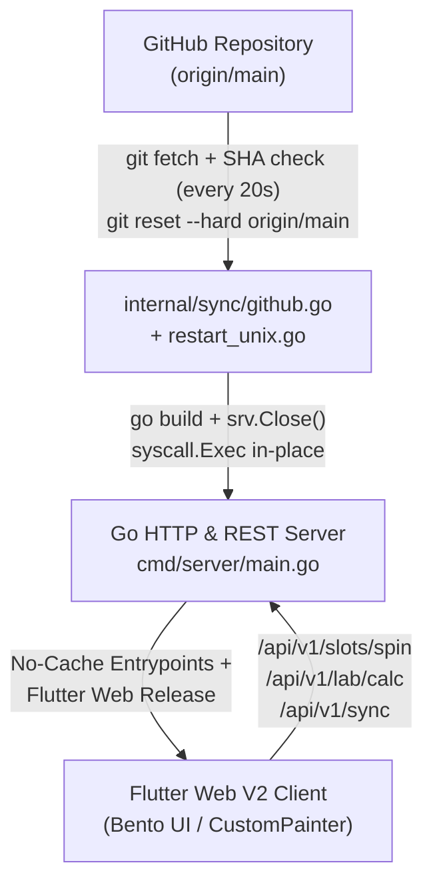

# BOZHEMAN ≡ PROTOCOL — Архитектурная Спецификация (V2 Bento + Self-Restart)

> **Версия:** 11.0 (Go Auto-Rebuild Backend + Flutter Web V2 Luxury Bento)  
> **Статус:** Production  
> **Стек:** Go (`go1.26` stdlib HTTP/REST + `syscall.Exec` Auto-Restart) + Flutter Web (`Flutter 3.50` / `Dart 3.14`)

---

## 1. Концепция «Три Мира» (V2 Luxury Dark Bento UI)

Интерфейс полностью очищен от визуального шума: плавающая стеклянная панель навигации (`HudBar`) переключает между **тремя сфокусированными мирами**, а анимированный фон (`AmbientCyberBackground`) создает глубину без потери читаемости:

1. **Мир 1 // `ХАБ` (`HomeScreen` — Social Highway):**
   * Hero-баннер с аватаром в орбитальном кольце, статусом `SYSTEM ONLINE` и быстрыми CTA.
   * Bento-сетка из 6 равновесных карточек (`Twitch`, `YouTube`, `Telegram @GrowerSim_bot`, `TikTok`, `Instagram`, `Поддержка / Донаты / Крипто`), а также модальное окно `SupportModal` с Donatello, Steam Trade, реферальными шлюзами и 4 крипто-кошельками (копирование + QR-коды).
   * Нижние порталы равного веса для перехода в `SLOTS 777` и `NEURAL LAB`.
2. **Мир 2 // `SLOTS 777` (`SlotsScreen` — Free-to-Play Arcade):**
   * Гемблинг ради азарта без реальных денег (`0% REAL MONEY // VIRTUAL CREDITS ₿ ONLY`).
   * Цилиндрические барабаны (`SlotReelWidget`) с лазерной линией выплат, эффектами частиц, режимами `TURBO` и `AUTO`, бесплатным пополнением `+1000 ₿`, ежедневным бонусом `+500 ₿` и серверным **Provably Fair SHA-256** (`/api/v1/slots/spin`).
3. **Мир 3 // `NEURAL LAB` (`LabScreen` — 3D Ядро, Генетика, Проекты и CLI):**
   * **3D Ядро и «Иллюзия»:** интерактивный 3D-икосаэдр с ударной волной (`Core3DPainter`, 10 кликов → `CORE_BREAKER`) и 7 фрагментов Ткачей (`WEAVER_INITIATE`, `+500 ₿`).
   * **Генетика Менделя:** калькулятор урожая и генетики `/api/v1/lab/calc` + searchable-руководство `@GrowerSim_bot`.
   * **Проекты и Терминал:** витрина проектов (`GrowerSim`, `Project: Terminus` с таймером, `Project: Nebula`), кнопка взлома ICE (`+250 ₿`), консоль `TerminalModal`, статус GitHub-синхронизации и галерея достижений `8/8`.

---

## 2. Поток Авто-Обновления и Перезапуска



---

## 3. Go Backend (`cmd/server`, `internal/`)

* **`internal/engine/slots.go`:** Криптографический `Provably Fair SHA-256` генератор 3 барабанов и выплат (`777 x10`, `★★★ x7`, `ΩΩΩ x5`, `▲▲▲ x3`, `■■■ x2`, `ЛЮБЫЕ 2 x1.5`).
* **`internal/engine/harvest.go`:** Математический движок симулятора Менделя (`biomass`, `thc`, `cupScore`, `bmanValue`, `mutationChance`).
* **`internal/engine/config.go`:** Канонический реестр ссылок, крипто-кошельки и проекты.
* **`internal/sync/github.go` + `restart_unix.go`:** Проверка GitHub каждые 20 секунд, автоматический `git reset --hard origin/main`, пересборка Go-бинарника на Linux и бесшовный `syscall.Exec` перезапуск.
* **`cmd/server/main.go`:** HTTP-сервер, строгие анти-кеш заголовки `Cache-Control: no-store, no-cache, must-revalidate, max-age=0` для JS/HTML/JSON, блокировка исходников, SPA fallback и legacy `.html` редиректы.

---

## 4. Запуск на Сервере (Ubuntu Server + Cloudflare Tunnel)

```bash
nohup env PORT=8080 ./run_laptop_server.sh > ~/server.log 2>&1 &
```
Скрипт `run_laptop_server.sh` работает в супервизорном цикле, автоматически подтягивая обновления с GitHub и перезапуская сервер при обновлениях или сбоях.
