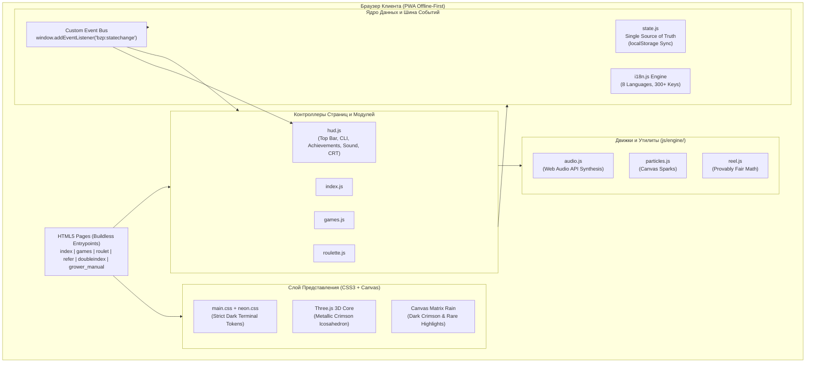

# BOZHEMAN ≡ PROTOCOL — Архитектурная Спецификация и Стандарты

> **Версия:** 9.0 (Architecture Audit & Clean Cyberpunk Standards)  
> **Статус:** Production  
> **Стек:** Vanilla HTML5, CSS3, ES6 Modules, Three.js, Web Audio API, PWA Service Worker (Buildless Architecture)

---

## 1. Концепция и Позиционирование

**BOZHEMAN ≡ PROTOCOL** — цифровой портал и экосистема стримера, инди-разработчика игр и медиа-автора BOZHEMAN.

### Баланс Главной Страницы (`index.html`)
1. **Главная страница — это авторский портал и визитка:**
   * Фокус на медиа-ресурсах (Twitch, YouTube, Instagram, TikTok), Игровом хабе (`games.html`), системных лабораториях и интерактивном кибер-ядре.
2. **Политика относительно казино (Слоты) и Телеграм-бота:**
   * Слоты (`roulet.html`) и бот (`@GrowerSim_bot`) являются **внутренними игровыми модулями**, а не предметом агрессивного промоушна на входе.
   * На главной странице **не допускаются**:
     * Мигающие бейджи баланса `[500 ₿]` на кнопке слотов;
     * Кислотно-зеленое выделение и пульсирующие маячки (`live-pulse`) для бота;
     * Огромные рекламные баннеры на весь экран.
   * Все 8 кнопок основной сетки обладают **равным визуальным весом**, строгим хай-тек стилем и одинаковой интерактивностью.

---

## 2. Диаграмма Архитектуры Системы

---

## 3. Декомпозиция Слоев

### 3.1. Слой Данных (`js/state.js`)
* **Роль:** Единственный источник истины (Single Source of Truth).
* **Схема состояния:**
  * `balance`: Баланс протокольных кредитов `₿`.
  * `growerId`: Уникальный идентификатор узла (`#GRW-XXXXX`).
  * `achievements`: Список разблокированных ID ачивок.
  * `stats`: Игровая статистика (спины, победы, джекпоты, открытые фрагменты).
  * `crtEnabled`, `audioMuted`, `matrixSpeed`: Настройки пользователя.
* **Правило мутации:** Прямое изменение `localStorage` запрещено. Все мутации проводятся исключительно через `State.set(...)`, вызывающий уведомление подписчиков через `CustomEvent('bzp:statechange')`.

### 3.2. Слой Интернационализации (`js/i18n.js` + `/locales/*.json`)
* **Поддерживаемые языки:** `ru`, `en`, `uk`, `be`, `pl`, `de`, `fr`, `es`.
* **Принцип:** 100% строковый паритет. Любой новый элемент интерфейса обязан регистрироваться во всех 8 файлах локалей.
* **Декларативное связывание:** через атрибуты `data-i18n`, `data-i18n-html`, `data-i18n-attr`, `data-page-title`.

### 3.3. Слой Телеметрии и HUD (`js/hud.js`)
* **Верхняя панель (`#protocol-top-bar`):**
  * Слева: Статус узла (`ONLINE`), разделитель и уникальный `Grower ID`.
  * Справа: Сдержанный чип кредитов и неакцентная ссылка на `@GrowerSim_bot`. Никаких мигающих точек и ярких рамок.
* **Интерактивный CLI-терминал (`#terminal-widget`):**
  * Доступен по горячей клавише `~` (тильда) или кнопке в HUD.
  * Поддерживает системные команды: `help`, `status`, `balance`, `daily`, `achievements`, `clear` и др.
* **Система Достижений (`ACHIEVEMENTS_CATALOG`):**
  * 8 протокольных ачивок с прогресс-барами, тостами разблокировки и наградами.

### 3.4. 3D-Сцена и Визуальные Эффекты (`js/index.js`, `js/matrix.js`)
* **3D-Ядро (Three.js):**
  * Геометрия: Внешний проволочный икосаэдр + внутренний рубиновый октаэдр + орбитальный торус.
  * Цветовая палитра: Глубокий багрово-красный металл (`0xaa1818`), титан (`0x881111`), приглушенная подсветка.
  * Освещение: Мягкие сбалансированные источники света без выгорания текстур.
* **Матричный Дождь:**
  * Фоновый атмосферный Canvas.
  * Темно-бордовые символы базового потока с редкими акцентными искрами (серебристо-белый, сдержанное золото).

---

## 4. Дизайн-Система: «Строгий Кибер-Терминал»

В проекте действует **запрет на пеструю/клоунскую визуальщину**:

| Элемент | Запрещено (Clownish Anti-pattern) | Принятый Стандарт (Clean Cyberpunk) |
|---|---|---|
| **Глобальный текст** | Размытый ореол `body { text-shadow: 0 0 4px ... }` | Четкий моноширинный шрифт без блюра (`text-shadow: none`) |
| **Заголовки** | 3-слойный блум в 30–60px | Контурный акцент 8–10px с низкой непрозрачностью |
| **Цвета акцентов** | Ядовито-розовый `#ff00de`, кислотно-зеленый `#00ff88` | Сдержанный багровый `#ff3333`, изумруд `#00e575`, золото `#e5b842` |
| **Кнопки** | Разрывание текста надвое и дрожание `liquid-wave` `skewX` | Тонкая акцентная грань сверху, элегантный сдвиг на 1px |
| **Фоновые эффекты** | Дрожащие сканлайны с радужным RGB-расщеплением | Спокойные монохромные сканлайны 4px с прозрачностью 0.3 |
| **Главная страница** | Выделение казино мигалками и бейджами `[500 ₿]` | Равноправные, строгие кнопки сетки одинакового размера |

---

## 5. Аудит Соответствия Навыкам (Skills Audit Matrix)

1. **Architecture & System Design:**
   * Четкое разделение ответственности: Data (`state.js`), Logic (`controllers`), Rendering (`canvas/three`), Layout (`html/css`).
   * Устранена путаница позиционирования: первая страница больше не мимикрирует под казино.
2. **Code Review & Refactoring:**
   * Удалены мусорные классы и хаотичные skew-анимации.
   * Код очищен от дублирующихся стилей и неоновых перегибов.
3. **Test-Driven Development & QA:**
   * Проверка синтаксиса JS на Node.js (`node -c`).
   * Валидация JSON всех 8 языковых словарей.
   * Проверка адаптивной сетки на брейкпоинтах 320px–2560px.
4. **Database & Migration Management:**
   * Валидация типов данных в `localStorage` при чтении/записи.
   * Защита от повреждения ключей состояния при обновлении версий кэша.
5. **DevOps & CI/CD Deployment:**
   * Buildless-архитектура: запуск без компиляции прямо через статический веб-сервер.
   * PWA Service Worker (`sw.js`) с кэшированием всех ассетов и страниц для автономной работы.
6. **API & Documentation:**
   * Полная техническая спецификация (`PROJECT_SPECIFICATION.txt`, `ARCHITECTURE.md`, `.agents/AGENTS.md`).
7. **Debugging & Log Analysis:**
   * Интегрированный кибер-терминал с выводом системных логов в реальном времени (`window.bzpTerminalLog`).
