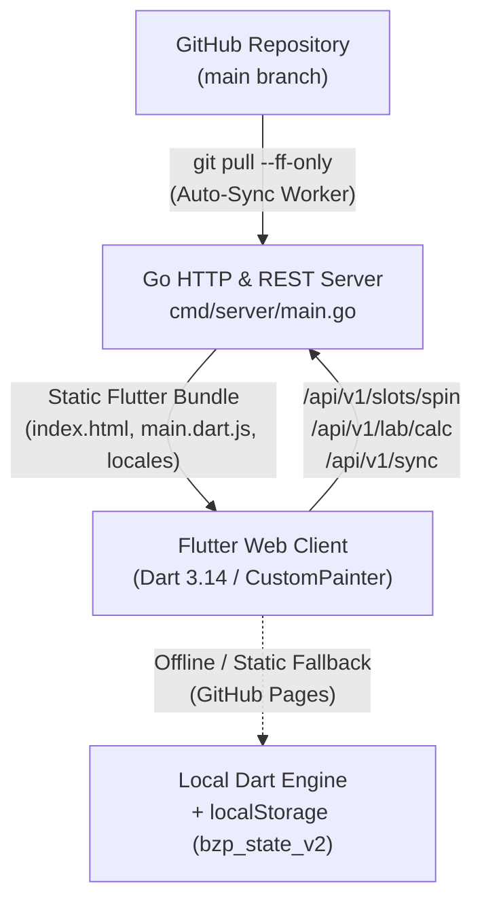

# BOZHEMAN ≡ PROTOCOL — Архитектурная Спецификация (Go + Flutter Web)

> **Версия:** 10.0 (Go Backend + Flutter Web + GitHub Laptop Sync)  
> **Статус:** Production  
> **Стек:** Go (`go1.26` stdlib HTTP/REST + GitHub Auto-Sync) + Flutter Web (`Flutter 3.50` / `Dart 3.14`)

---

## 1. Концепция «Трех Потоков» и Разгрузка Главной Страницы

Главная страница (`/`) максимально облегчена: удалены тяжелый Three.js-рендер, блокирующий прелоадер и навязчивый авто-терминал. Вместо них пользователь сразу видит лаконичный интерфейс стандарта **Clean Concise Cyberpunk** (`#000000`, `#100606`, `#ff3333`, `#e5b842`, `#00e575`, моноширинный `Fira Code`) с тремя четкими маршрутами:

1. **Поток 01 // Магистраль Соцсетей (`Social Highway`):**
   * Равновесная сетка кнопок прямого перехода на `Twitch`, `YouTube`, `Instagram`, `TikTok`, `Telegram (@GrowerSim_bot)`, `Donatello`, `Игровой Хаб` и `Крипто-шлюзы`.
   * Мгновенное копирование адреса узла `https://bozheman.com`.
2. **Поток 02 // Слоты 777 Без Вложений (`Free-to-Play Arcade`):**
   * Гемблинг ради гемблинга без реальных денег (`0% REAL MONEY // VIRTUAL CREDITS ₿ ONLY`).
   * Анимированные барабаны (`CustomPainter`), режимы `TURBO` и `AUTO`, бесплатное пополнение `+1000 ₿`, ежедневный бонус `+500 ₿` и проверка честности **Provably Fair SHA-256** через Go API (`/api/v1/slots/spin`).
3. **Поток 03 // Лаборатория, Лор и 3D-Ядро (`Explorer & Lab`):**
   * **GrowerSim Lab (`/#/lab`):** Калькулятор Харвеста и Генетики Менделя (`/api/v1/lab/calc`) + 6-секционный searchable-мануал `@GrowerSim_bot`.
   * **Протокол «ИЛЛЮЗИЯ» & 3D-Ядро (`/#/illusion`):** Нативное 3D-ядро на `CustomPainter` (10 кликов для дешифровки `CORE_BREAKER`) и 7 фрагментов Ткачей с эффектом печатной машинки (`WEAVER_INITIATE`, `+500 ₿`).
   * **Игровой Хаб (`/#/games`) и Крипто-шлюзы (`/#/support`):** Поиск, фильтры, scannable QR-коды (pure-Dart ISO-18004 encoder) и CLI-терминал (`~`).

---

## 2. Структура Новой Архитектуры



---

## 3. Go Backend (`cmd/server`, `internal/`)

* **`internal/engine/slots.go`:** Криптографический `Provably Fair SHA-256` генератор 3 барабанов и выплат (`777 x10`, `★★★ x7`, `ΩΩΩ x5`, `▲▲▲ x3`, `■■■ x2`, `ЛЮБЫЕ 2 x1.5`).
* **`internal/engine/harvest.go`:** Математический движок симулятора Менделя (`biomass`, `thc`, `cupScore`, `bmanValue`, `mutationChance`).
* **`internal/engine/config.go`:** Канонический реестр ссылок, крипто-кошельков и модулей экосистемы.
* **`internal/sync/github.go`:** Фоновая и ручная авто-синхронизация ноутбука-сервера с GitHub (`BZP_AUTO_PULL=true`, `GET /api/v1/sync/status`, `POST /api/v1/sync`).
* **`cmd/server/main.go`:** HTTP-сервер, CORS, блокировка доступа к исходникам/секретам, редиректы со старых `.html` путей (`/roulet.html` -> `/#/slots` и т.д.) и SPA fallback.

---

## 4. Запуск на Ноутбуке-Сервере

```powershell
# Windows (автоматически собирает Go-сервер и включает git pull с GitHub каждые 5 минут):
.\run_laptop_server.ps1
```

```bash
# Linux / macOS:
./run_laptop_server.sh
```
